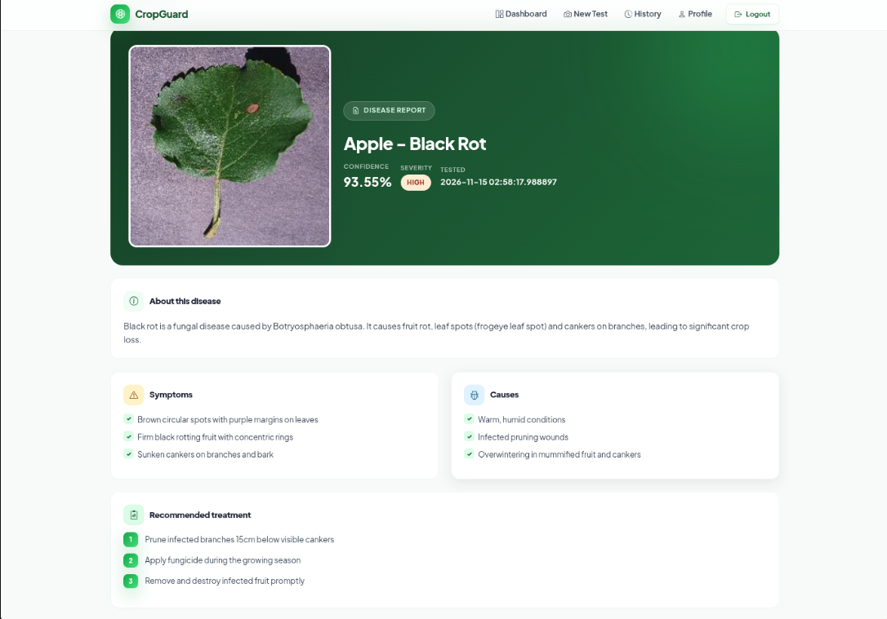

# 🌿 CropGuard — AI-Based Crop Disease Detection Web App

CropGuard is a modern, AI-driven web application that helps farmers detect crop diseases by simply uploading a leaf image. The system uses **YOLOv8 for leaf verification** and **MobileNetV2 (Transfer Learning)** for accurate disease classification, then generates a **complete treatment report** with symptoms, causes, prevention and organic options.

---

## 🔍 Key Features

- ✅ **Leaf Image Verification** with YOLOv8 to ensure valid crop leaf input
- 🌱 **Disease Prediction** using MobileNetV2 trained on 38-class PlantVillage dataset
- 📄 **Full Disease Report** — symptoms, causes, prevention, step-by-step treatment & organic options
- 💊 **Treatment Suggestions** based on detected disease
- 📷 **Modern, responsive UI** with drag-and-drop upload, confidence score & severity indicator
- 🗂️ **Lightweight Deployment** using Flask and SQLite
- 📊 **Evaluation** with >94% test accuracy and real-user testing

---

## 🧠 Model Info

- Model: **MobileNetV2**
- Dataset: [PlantVillage Dataset](https://www.kaggle.com/emmarex/plantdisease)
- Accuracy: **94%+**
- YOLOv8s used for **image validation**

---

## 🧪 Technologies Used

- Python, TensorFlow, Keras, OpenCV, Ultralytics YOLOv8
- Flask (Backend) + HTML/CSS/Bootstrap (Frontend)
- SQLite (Local Database)
- Google Colab (Model Training)

---

## 🚀 Getting Started

### Prerequisites

- Python 3.8+
- pip (Python package manager)

### Installation

1. **Clone the repository**

   ```bash
   git clone https://github.com/Aman-00007/Ai-Crop-Disease-Detection.git
   cd Ai-Crop-Disease-Detection
   ```

2. **Create and activate a virtual environment**

   ```bash
   python -m venv .venv
   source .venv/bin/activate   # On Windows: .venv\Scripts\activate
   ```

3. **Install dependencies**

   ```bash
   pip install -r requirements.txt
   ```

4. **Run the application**

   ```bash
   python app.py
   ```

5. **Open your browser** and go to `http://127.0.0.1:5000`

### Usage

1. Sign up for an account (or log in if you already have one).
2. Navigate to the **New Test** page.
3. Upload a clear photo of a crop leaf (drag-and-drop or click to browse).
4. The app verifies the image with YOLOv8, then classifies the disease using MobileNetV2.
5. View the predicted disease, confidence score, and recommended treatment.
6. Click **View Full Report** for a detailed breakdown — symptoms, causes, prevention, treatment steps and organic options.
7. Check your **History** page to review past tests.

---

## 📸 Demo Screenshot

Below is a sample **disease report** generated by CropGuard after analysing an apple leaf infected with Apple Scab. The report shows the predicted disease, confidence score, severity, and a complete breakdown of symptoms, causes, prevention, treatment steps and organic options.



---

## 📌 Future Improvements

- 📱 Mobile App version
- 🌐 Multilingual interface
- 🌍 GPS-based disease mapping
- ☁️ Cloud deployment

---

## 👤 Author

**Aman Rawat**  
Email: itzamanrawat123@gmail.com  
GitHub: [Aman-00007](https://github.com/Aman-00007)

---

⭐ Feel free to star this project if you find it useful!
